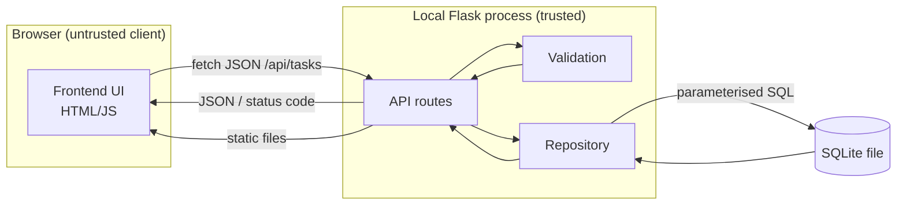

# Architecture: Simple Todo Application

Status: DRAFT. Produced by the solution-architect. Not design-reviewed. Not approved by a human.
Traces to: `requirements.md` (FR-1..FR-8, NFR-1, NFR-A1..A4, A1..A9, Q1..Q9).
Run branch: `story/todo-application-20261110090358-f560b4ea`

## 1. Goals and Constraints

- Deliver basic CRUD plus completed/pending toggle, persisted in a database, with a simple browser UI and an HTTP backend (FR-1..FR-7).
- No authentication (FR-8). Tasks are one global list (A5).
- Minimal and easy to run locally with documented steps (NFR-A2, A8, Q9).
- Out of scope: accounts, due dates, priorities, tags, search, filtering, reordering, hosting/deployment (requirements section 9).

## 2. Decisions on Open Questions (all ASSUMPTIONS, unconfirmed)

| Ref | Question | Decision (assumption) |
|-----|----------|-----------------------|
| Q1/A8 | Stack and DB | Python 3.10+, Flask backend, SQLite via stdlib `sqlite3`, vanilla HTML/CSS/JS frontend served by Flask. Rationale: one runtime, one dependency (Flask) plus pytest for tests, no native build step, no separate DB server, no frontend build toolchain. |
| Q2/A1 | Fields | `id` (integer, auto), `description` (text), `completed` (boolean, default false), `created_at` (UTC timestamp). Nothing else. |
| Q3/A2/A7 | Validation | Description is trimmed; empty after trim is rejected; max 255 characters after trim; duplicates allowed. |
| Q4/A4 | Delete confirm | No confirmation; immediate delete. |
| Q5/A5 | Per-user data | Single global list, acceptable given no auth. |
| Q6 | NFRs | No performance, browser or accessibility targets. Best effort: current evergreen browsers, semantic HTML with labelled controls. |
| Q7/A9 | Ordering | Creation order (ascending `id`). No filtering or sorting controls. |
| Q8 | Page ID | Not an architecture concern; still unconfirmed. |
| Q9 | Hosting | Local run only. Dev server, bound to 127.0.0.1. |

Alternative considered: Node/Express + React. Rejected as heavier (build toolchain, native sqlite module or separate DB) for a story that asks for the minimum. If the stakeholder mandates a stack (Q1), components below remain valid; only technology changes.

## 3. Components and Responsibilities

| Component | Responsibility | Traces to |
|-----------|----------------|-----------|
| Frontend (static `index.html`, `app.js`, `styles.css`) | Render task list, add form, per-task toggle, inline edit, delete; call the API with `fetch`; show error messages; load list on page load. Renders text with `textContent` (never `innerHTML`). | FR-1..FR-6, NFR-1, NFR-A1 |
| HTTP API layer (Flask routes) | Route requests, parse JSON, call validation, map results/errors to status codes and JSON bodies; serve static frontend. | FR-7 |
| Validation module | Single place for description rules (trim, non-empty, max length) and type checks on `completed`. | A2, A7, NFR-A1 |
| Repository / data access | All SQL; parameterised queries only; create, list, get, update, delete. Owns connection handling per request. | FR-1..FR-6 |
| SQLite database (single file) | Durable storage of the `tasks` table. Schema created on startup if absent. | F5, FR-6, FR-7 |
| Config | DB file path via environment variable (default `todo.db` in a data dir), host/port. No secrets. | NFR-A2, NFR-A4 |
| Tests (pytest) | API/repository tests against a temporary database; validation unit tests. | NFR-A3, T1..T7 |

Suggested layout (for the planner, not binding): `app/` (factory, routes, validation, repository, static files), `tests/`, `requirements.txt`, README run/test steps. `todo.db` and data dir are git-ignored.

## 4. Data Model

Table `tasks`: `id INTEGER PRIMARY KEY AUTOINCREMENT`, `description TEXT NOT NULL` (length constrained by validation, optionally a CHECK constraint), `completed INTEGER NOT NULL DEFAULT 0` (0/1), `created_at TEXT NOT NULL` (ISO-8601 UTC). No migrations framework (limitation: schema changes need manual handling).

## 5. API Contract (JSON, base path `/api`)

| Method and path | Purpose | Success | Errors |
|-----------------|---------|---------|--------|
| `GET /api/tasks` | List all tasks ordered by `id` | 200, array | 500 |
| `POST /api/tasks` body `{description}` | Create (pending) | 201, created task | 400 validation, 415 non-JSON, 500 |
| `PATCH /api/tasks/<id>` body `{description?, completed?}` | Edit text and/or set status | 200, updated task | 400 validation, 404 unknown id, 500 |
| `DELETE /api/tasks/<id>` | Delete | 204 | 404 unknown id, 500 |

- Toggle is `PATCH` with explicit `completed: true|false` (idempotent; avoids race on a server-side flip). Frontend sends the inverse of the displayed value.
- PATCH requires at least one known field; unknown fields are ignored or rejected with 400 (decision for planner; recommend reject).
- Error body shape: `{"error": "<message>"}`. Messages are generic; no stack traces or SQL.
- `<id>` is parsed as a positive integer; otherwise 404.

## 6. Data Flow

Flows:
1. Page load: browser gets static files, then `GET /api/tasks`; list rendered (FR-2, FR-6).
2. Add: form submit -> `POST` -> validate -> insert -> 201 -> UI appends or reloads list (FR-1).
3. Toggle/edit: `PATCH` -> validate -> update -> 200 -> UI updates row (FR-3, FR-4).
4. Delete: `DELETE` -> remove row -> 204 -> UI removes row (FR-5).
5. UI treats the server response as the source of truth; on failure it keeps prior state and shows an error.

## 7. Trust Boundaries

1. Browser to server: all request data (JSON body, path ids) is untrusted and validated server-side regardless of client-side checks.
2. Server to database: only parameterised SQL; no string-built queries.
3. Database to browser: stored descriptions are treated as untrusted on output; frontend uses `textContent`; JSON responses use `application/json`. This prevents stored XSS.
4. Network exposure: bound to `127.0.0.1` by default. Because there is no authentication (FR-8), the API must not be exposed to untrusted networks; documented as a limitation.
5. No secrets exist; config via environment variables; nothing sensitive committed (NFR-A4).
6. CSRF/CORS: same-origin only (frontend served by the same app); no CORS headers enabled. Residual CSRF risk from other local web pages is mitigated by requiring `Content-Type: application/json` (non-simple request); accepted as low risk for a local no-auth app.

## 8. Input Validation

- `description`: must be a string; trimmed; length 1..255; otherwise 400 with a clear message shown in the UI.
- `completed`: must be a JSON boolean.
- Request body size limited (e.g. via Flask `MAX_CONTENT_LENGTH`, ~10 KB).
- Client-side mirrors rules (maxlength, non-empty) for feedback only; not relied upon.

## 9. Failure Behavior

| Failure | Behavior |
|---------|----------|
| Validation error | 400 with message; nothing persisted; UI shows message, keeps input. |
| Unknown task id | 404 `{"error": ...}`; UI shows message and refreshes list. |
| Malformed JSON / wrong content type | 400 / 415 with generic message. |
| DB unavailable, locked or write failure | Transaction rolled back; 500 generic error; details logged server-side only; UI shows "could not save, try again". |
| Backend unreachable | `fetch` fails; UI shows connection error; existing rendered list is left unchanged. |
| DB file missing at start | Created with schema automatically. |
| Corrupt DB file | Startup fails with a clear log message; no auto-repair. |
| Concurrent edits (two tabs) | Last write wins; no optimistic locking (accepted limitation). |

## 10. Testability

- App factory accepts a DB path so tests use a temporary database; no shared state.
- Pytest API tests via Flask test client cover T1..T6: add (default pending), list count, toggle both ways with persistence, edit, delete, persistence across a new app instance on the same DB file (stand-in for refresh).
- Validation tests: empty, whitespace-only, 255 vs 256 characters, non-string, non-boolean `completed`, unknown id, malformed JSON.
- T7 (no login): tests call endpoints with no credentials.
- Security check: a test that a description containing HTML is returned verbatim as JSON data (escaping is a frontend concern, verified by manual check or optional browser test).
- Browser-level end-to-end refresh test (T6 in a real browser) is optional; if not automated, verification must record it as a manual check, not as passed.

## 11. Limitations

- Single global list, no users, no auth; not safe for public exposure.
- Flask dev server only; no production deployment, TLS, or scaling.
- SQLite single-writer; fine for one local user.
- No pagination (all tasks returned), no filtering/sorting, no undo for delete.
- No schema migrations.
- No stated performance, browser or accessibility targets (Q6); UI "simple and user-friendly" (NFR-1) is subjective and verified only by review.

## 12. Open Decisions for Review

- OD1. Confirm stack (Q1). Assumed Python/Flask/SQLite/vanilla JS.
- OD2. Reject or ignore unknown PATCH fields (recommend reject).
- OD3. Whether to include `created_at` (A1 says optional).
- OD4. Whether to add an automated browser test for refresh persistence.
- OD5. Remaining requirement questions Q2..Q9 stay unconfirmed assumptions per section 2.

## 13. Review and Approval Status

- Design review: NOT PERFORMED.
- Architecture approval: NOT APPROVED. This is an automated draft awaiting review.
